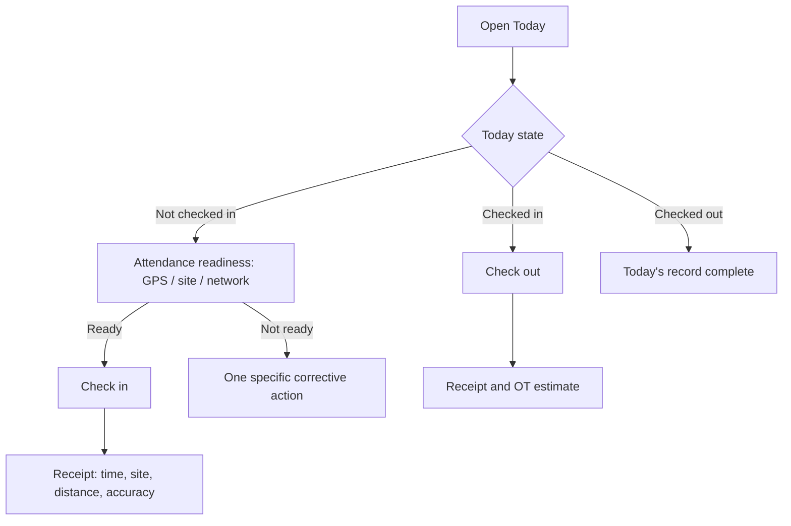
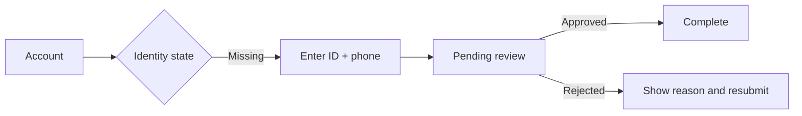

# Enterprise APK Audit — BVN Package Employee Mobile

**Audit date:** 25 November 2026  
**Scope:** Flutter employee Android app (`employee_mobile`), its Edge Function contract (`supabase/functions/swift-handler`), Android manifest/build configuration and automated tests.  
**Not in scope:** authenticated production database inspection, penetration testing, API load test, device-farm testing, iOS build, or usability sessions with real employees.

## Executive verdict

**Decision: REFACTOR, not rebuild.**

The product already has a meaningful employee workflow: authentication, GPS check-in/out, a month calendar, leave, request tracking, advance requests, identity approval and password recovery. The current architecture is recoverable because the mobile client uses a thin API boundary and the backend validates key attendance rules. Rebuilding would discard working payroll/attendance logic without solving the actual commercial gaps.

However, this is **not ready for a commercial release**. It is a credible internal pilot, not an enterprise product. The largest risks are a version/update mismatch that can create a forced-update loop, bearer mobile tokens stored as raw database values, no mobile session expiry, and no evidence of device/network/security acceptance testing. UI has improved, but the product is still organised as five equal tabs rather than around the employee's primary job: “start work, prove location, finish work, resolve exceptions”.

### Remediation started after this audit

The source checkout now contains, but has **not deployed**, two Phase 1 repairs: APK update constants now match `1.0.14+14` and are regression-tested; mobile-session hardening now hashes new tokens and gives them a 30-day expiry. The accompanying SQL migration deliberately revokes legacy mobile sessions because raw bearer tokens cannot be converted safely. Production status remains unverified until UAT migration, Edge Function deployment and physical login/check-in testing are completed.

## Evidence and confidence

| Finding type | Evidence | Confidence |
|---|---|---|
| Source-confirmed | Flutter/Dart, Android manifest and Edge Function reviewed in this repository | High |
| Test-confirmed | `flutter analyze` completed with no issues; `flutter test` completed 10/10 in the latest APK work | High |
| Build-confirmed | Release APK was built locally on 25 Nov 2026 | High |
| Runtime/device/security claims | No production telemetry, device test, penetration test or authenticated UAT supplied | Not scored / requires validation |

## Product analysis

### What it solves

It digitises attendance for Thai operational employees: GPS-bound check-in, check-out, current shift guidance, calendar-based time transparency, leave and advance requests, and a route to correct personal identity information.

### Target users

1. **Employee:** needs one obvious action at shift start/end, confidence that the action succeeded, and a simple way to request leave or check payroll-impacting history.
2. **Supervisor/Admin:** needs reliable GPS evidence, exceptions, approvals and payroll-ready data.
3. **Company owner:** needs a system that can be configured, supported, audited and eventually offered to another company.

### Uncomfortable product truth

The app is good at collecting attendance, but weak at explaining the employee's **next required action** and at handling the exception paths that generate support calls: location unavailable, GPS inaccurate, already checked in, incorrect day, device changed, no network, or approval delayed. The monthly calendar is more sophisticated than the exception resolution experience. That is backwards for a field workforce product.

## Screen-by-screen audit

Scores are design/source-review scores, not device benchmark scores. Performance is **N/A** where no measurement exists.

| Screen | Purpose / current workflow | UX | UI | Performance | Workflow | Maintainability | Priority |
|---|---|---:|---:|---:|---:|---:|---|
| Login / device activation | Select employee, enter password, receive saved mobile token | 6 | 6 | N/A | 6 | 6 | High |
| Today / check-in-out | Read shift, see map, submit GPS attendance | 7 | 7 | N/A | 7 | 5 | High |
| Work time / month calendar | Browse attendance month and selected day | 6 | 7 | N/A | 6 | 5 | Medium |
| Leave request | Select leave type/date/reason and submit | 6 | 6 | N/A | 6 | 5 | Medium |
| Requests | Review leave, OT and advance status | 6 | 6 | N/A | 6 | 5 | Medium |
| Account / Work Identity | View work identity, personal-data state and security actions | 7 | 7 | N/A | 7 | 6 | Medium |
| Update prompt | Open external APK URL when backend advertises an update | 3 | 5 | N/A | 2 | 4 | **High** |

### 1. Login / device activation

**What works:** errors are shown; token is stored using `flutter_secure_storage`; the backend rate-limits failed logins and revokes prior sessions when a new login succeeds.

**What is weak:** the client downloads a complete active employee directory before login. This makes identity selection easy, but leaks the company roster and role labels to any caller of the public action. It also does not communicate whether a device has been trusted, replaced, or revoked.

| Problem | Root cause / evidence | Impact | Proposed solution | Priority |
|---|---|---|---|---|
| Employee directory is public | `employee_directory()` does not authenticate in the Edge Function | Roster enumeration and unnecessary data exposure | Replace picker with employee ID first; return display name only after successful authentication, or add rate limiting and an organisation-scoped lookup | High |
| Device trust is invisible | Device label is hard-coded as `Android app`; no device management UI | Support cannot explain or revoke a lost device session | Store a generated device ID, show active devices in Account, offer “sign out other devices” | Medium |
| Password policy differs by role | employee password accepts six characters; admin flow requires eight | Inconsistent security posture | One documented policy: minimum 10 chars or a PIN policy with server-side throttling and reset lifecycle | Medium |

### 2. Today / check-in-out

**What works:** it is the right landing screen; check-in/out is a single primary button; GPS, mock-location and site-radius decisions are enforced server-side; the UI shows shift and current status.

**What is weak:** the map occupies the central working area whenever GPS is required. For most employees, the map is evidence, not the task. The screen's real decision is “Can I check in now?” but the product makes the employee infer that from a map, GPS state and button outcome.

| Problem | Root cause / evidence | Impact | Proposed solution | Priority |
|---|---|---|---|---|
| Primary action is competing with a map | `_Today` expands `_CheckInMap` to fill remaining vertical space | More scrolling/visual weight before the one action users need | Replace always-open map with a compact “ตำแหน่งพร้อม / ห่าง X ม.” status card; open the full map only on tap or failure | High |
| Weak recovery for GPS/network failure | Generic snackbars and several silent catches; no persistent diagnostic state | Employee repeats taps or calls admin without usable evidence | A failure sheet: GPS off / permission denied / accuracy too low / outside radius / offline, each with one corrective action and retry | High |
| No submission receipt | After a successful action, state refreshes but there is no durable confirmation reference | Disputes are harder to resolve | Show time, site, distance, accuracy and sync state after submit; keep a local pending event only if offline support is designed | Medium |
| Single large state class | `EmployeeShell` owns refresh, notification scheduling, identity checks, attendance and navigation | Small changes risk unrelated workflows | Split into `session`, `attendance`, `profile` and presentation controllers | Medium |

### 3. Work time / month calendar

**What works:** monthly navigation, calendar status colours, holiday/OT semantics and selected-day detail are valuable. The server provides a monthly summary rather than forcing the app to derive payroll rules locally.

**What is weak:** dense colour legend and per-day cards ask employees to learn internal statuses. The calendar is a reporting surface, but it does not sharply distinguish “needs your action”, “approved”, “pending admin review” and “informational history”.

| Problem | Impact | Proposed solution | Priority |
|---|---|---|---|
| Too many status colours at once | Colour-only cognition is difficult under bright field conditions and for low-vision users | Use icon + short label in selected-day detail; reserve strong colour for exception/pending states | Medium |
| No clear correction route | Employee sees an unusual day but cannot understand where to resolve it | When a day is incomplete, show a clear “ติดต่อผู้ดูแล / ส่งคำขอ” path if the business enables it | Medium |
| Month data is a monolithic response | Calendar rendering/summary logic is coupled to a large map | Harder to test boundary conditions such as partial shifts and future dates | Create typed DTOs and separate calculator/view-model tests | Medium |

### 4. Leave request

**What works:** the validation avoids blank reasons and reversed dates.

**What is weak:** it is only a form. It gives no leave balance, approval expectation, conflicts with existing leave, holiday context, or preview of the inclusive days requested.

| Problem | Impact | Proposed solution | Priority |
|---|---|---|---|
| No leave entitlement/balance | Employees submit requests blind and admin receives preventable requests | If policy supports it, display balance and affected workdays before submit; otherwise explicitly state “บริษัทไม่ติดตามโควตาในแอป” | Medium |
| No confirmation state on the form | Uncertainty after tap produces duplicate requests | Show submitted request card with status and request date immediately | Medium |
| Date selection lacks contextual guardrails | Users can choose non-workdays or dates with existing leave | Mark existing requests/holidays in picker or validate with clear inline reason | Low |

### 5. Requests

**What works:** one place for leave, advances and auto-calculated OT is sensible; filtering reduces scanning.

**What is weak:** this is an archive, not an action inbox. Pending requests do not explain the next owner, expected time, reviewer note, or effect on salary. It also mixes three domains whose priority differs.

| Problem | Impact | Proposed solution | Priority |
|---|---|---|---|
| “My requests” hides urgency | Employee cannot see the one item blocking action | Default to “ต้องดำเนินการ / รอตรวจ” then history; add clear status-copy and timestamps | Medium |
| Leave, OT, advance are visually equivalent | Financial request can be missed among low-risk leave requests | Use a grouped inbox with financial status/payment milestone distinct from leave approval | Medium |

### 6. Account / Work Identity

**What works:** latest redesign establishes a much better work identity hierarchy, separate account and identity state, GPS policy, and ordered security actions. Pending identity review is now distinct from missing data.

**What is weak:** the Account tab mixes durable profile information with risky actions (password reset/logout) but still has no device/session management, consent explanation for precise location, or support identifier.

| Problem | Impact | Proposed solution | Priority |
|---|---|---|---|
| GPS purpose and retention are not explained | Users may perceive tracking as continuous surveillance | Show a concise consent/usage link: when location is captured, why, who sees it, retention contact | High |
| No device/session controls | Lost phones retain sessions until next login occurs | Server-issued expiry plus device list/revoke; surface last active date | High |
| Identity workflow lacks rejected-state explanation | Employee may only see incomplete data again | Return rejection reason and a single resubmit action | Medium |

## Feature audit

| Type | Feature | Decision / reason |
|---|---|---|
| KEEP | GPS validation on backend | Critical attendance integrity; retain server-side decision making |
| KEEP | Month calendar + payroll-aware server calculation | Valuable transparency; reduce UI density rather than remove |
| KEEP | Secure-storage session persistence | Better than plain shared preferences; retain with expiry/rotation |
| IMPROVE | Check-in map | Convert to an on-demand proof/debug view, not the default dominant layout |
| IMPROVE | Leave form | Add workday preview and policy/balance context |
| IMPROVE | Requests list | Make it an action-first inbox with unambiguous states |
| IMPROVE | APK updater | Fix version parity; use signed release distribution and reliable update lifecycle |
| MERGE | Today status, map readiness and check-in action | One “Attendance readiness” card with progressive disclosure |
| MERGE | Profile completeness + identity request state | One Work Identity card with Complete / Pending / Needs action / Rejected states |
| REMOVE | Public full employee-directory picker | Replace with employee-ID first flow or protected lookup |
| ADD | Session/device management | Needed for lost-device response and commercial support |
| ADD | Offline policy | Either queue securely and declare limitations, or explicitly block and explain no-network attendance; do not leave it implicit |
| ADD | Observability | Crash reporting, API error correlation ID, release health dashboard and privacy-safe analytics |

## Workflow redesign

### Attendance

**Current:** map + status + action, then generic snackbar on failure.  
**Proposed:** action is visible first; the map/error detail opens only when required.  
**Expected improvement:** fewer failed retries and support calls; no added business rule.

### Personal identity

**Current:** incomplete and pending states were previously conflated; the latest APK fix now separates pending from missing.  
**Next improvement:** return and display rejection rationale; do not repeatedly interrupt attendance for optional profile completion.

## Architecture, performance and security audit

### Confirmed architecture strengths

- Flutter client has a single `BvnApi` transport boundary and short-lived read cache.
- Sensitive server credentials remain in Supabase Edge Function environment variables, not in the APK.
- Server validates attendance event order, location requirement, active employee status and mock-location input.
- RLS starter policy intentionally blocks direct anonymous/authenticated table access; Edge Function performs trusted access.
- Password code uses PBKDF2 for newly written credentials and attempts legacy upgrade on login.

### Confirmed defects / risks

| Problem | Evidence | Impact | Proposed solution | Priority |
|---|---|---|---|---|
| **APK version parity is broken** | `pubspec.yaml` is `1.0.14+14`; `lib/update.dart` declares `1.0.13` / `13` | Backend can repeatedly advertise an update to a binary already installed; forced update can block users | Make app version a generated single source of truth from `package_info_plus` or build-time defines; add CI assertion that update constants equal package version | **High** |
| **Mobile token is stored as raw bearer value** | Edge Function writes `token_hash: tk` and queries it directly; no hash transformation | Database read or log exposure yields a usable session token | Store only SHA-256/HMAC token digest, compare digest, show token prefix only for support; rotate/revoke on suspect use | **High** |
| **Mobile token has no expiry** | `mobile_access` has no expiry field; `authMobile` only checks active status | Lost or copied device session can survive indefinitely | Add `expires_at`, refresh/rotation, inactivity expiry, and revoke-all action | **High** |
| **Employee directory is unauthenticated** | `employee_directory` handler has no `authMobile`/challenge | Active roster and roles are enumerable | Employee ID-first login; rate limit and minimise response data | **High** |
| CORS is open to all origins | `Access-Control-Allow-Origin: *` | Increases abuse surface for public endpoints; not by itself a proof of compromise | Restrict admin browser origins, rate-limit public mobile endpoints, add WAF/abuse observability | Medium |
| Sensitive data lifecycle is incomplete | National ID and phone are stored in request and employee tables; no demonstrated encryption-at-rest/key policy/retention purge for approved identity details | PDPA/commercial procurement risk | Define data classification, retention, access audit, export/delete process and legal basis; perform a privacy review | High |
| Monolithic UI file | `main.dart` contains shell and all screen implementations | Regression risk and slow change reviews | Feature folders + typed repositories/view-models + reusable state components | Medium |
| Duplicate API handler sources | both `swift-handler/index.ts` and `bvn-api/index.ts` exist | Future fixes may deploy one function while engineers edit another | Select one canonical function, delete/archive the duplicate and add deployment guard/version check | Medium |
| README is boilerplate | employee README is unchanged Flutter starter | Product cannot be supported or handed over reliably | Document build, signing, env config, release, rollback, privacy permissions and test matrix | Medium |

### Performance judgement

**Score: N/A.** No startup timings, network traces, memory profile, ANR/crash rate, or field device results were available. Source does show mitigations (short API cache, `Future.wait` on initial refresh, no heavy local database), but that is not performance proof.

**Required measurements before release:** cold/warm startup on low-end Android, check-in click-to-confirm P50/P95, map first paint, API timeout/error rate, battery cost during location capture, memory/ANR/crash-free sessions and 3G/offline behaviour.

## Commercial product readiness

### Tenant model recommendation

**Recommended: hybrid multi-tenant architecture.**

Use shared product code and a shared control plane, but isolate each company through an immutable `tenant_id` on every business table, tenant-scoped API claims, strict RLS and per-tenant encryption/backup policy. Offer a dedicated database/project only for regulated or large customers.

The present data model is effectively **single tenant**: business tables use global employee IDs/settings and API requests are not tenant-scoped. Do not sell it as multi-company before tenant isolation is implemented and tested.

| Commercial capability | Status from source | Requirement before sale |
|---|---|---|
| Multi-company | Not evidenced / current schema not tenant-scoped | Tenant model, isolated auth claims, migration and cross-tenant tests |
| Multi-user / RBAC | Partial | Formal role matrix, permission tests and audit coverage |
| Subscription / licence | Not found | Entitlements, billing lifecycle, feature flags and suspension policy |
| Backup / recovery | Partial scripts only | Automated backup, restore drill and documented RPO/RTO |
| Audit log | Partial and best-effort | Immutable/reviewable audit events for security, data and finance actions |
| Update mechanism | Exists but parity defect | Signed release channel, version automation, rollback and release notes |
| Support / observability | Not found | Crash/error monitoring, support ID, health dashboards and runbooks |

## Final scorecard

| Evaluation | Score | Basis |
|---|---:|---|
| Product Quality | 5.5/10 | Useful core workflow, but exception and commercial workflow incomplete |
| UX | 6.0/10 | Clearer after recent redesign; map/error/recovery still inefficient |
| UI | 6.5/10 | Coherent palette/components; dense calendar and hierarchy can improve |
| Performance | N/A | No measured evidence |
| Architecture | 5.5/10 | Thin API boundary is good; monolith and duplicate handlers hurt |
| Security | 4.0/10 | Secure storage/PBKDF2/RLS intent help; raw token/no expiry/public directory block release |
| Workflow | 6.0/10 | Happy path good, exception/support path weak |
| Maintainability | 5.0/10 | Tests exist, but low breadth, weak docs and oversized main file |
| QA & Reliability | 4.5/10 | Analyze + 10 tests pass; no integration/device/network/regression matrix evidenced |
| Commercial Readiness | 3.5/10 | Pilot ready with controls; not multi-tenant/commercial ready |

**Overall: 5.1/10 — internal pilot only, conditional on Phase 1 fixes.**

## Four-phase roadmap

### Phase 1 — Critical fixes (release blocker)

| Task | Priority | Complexity | Dependency | Acceptance criteria |
|---|---|---|---|---|
| Unify APK version source | High | Low | CI/build config | Built APK version, update checker and backend manifest agree in an automated test |
| Hash + expire mobile sessions | High | Medium | DB migration + backend deploy | Raw token cannot authenticate after DB exposure; expired/revoked token is rejected; device revoke tested |
| Protect/remove public roster endpoint | High | Medium | Login UX decision | Unauthenticated endpoint cannot enumerate active employees; login remains accessible |
| Identity/GPS privacy policy | High | Medium | Product/legal decision | In-app notice, documented retention/access, approval owner and support channel |
| Release signing and rollback proof | High | Medium | Keystore/CI | APK signed by release key, install/upgrade/rollback tested on physical Android |

### Phase 2 — UX/UI and workflow

| Task | Priority | Complexity | Dependency | Acceptance criteria |
|---|---|---|---|---|
| Attendance readiness redesign | High | Medium | None | User can identify and execute/check remedy in one screen without map-first friction |
| Explicit failure/receipt states | High | Medium | Error contract | GPS/offline/outside-radius/duplicate cases display a specific remedy and support-safe receipt |
| Action-first request inbox | Medium | Medium | Backend fields for reviewer timeline | Pending action is visible within one tap; history is secondary |
| Leave preview/balance policy | Medium | Medium | Business policy | Form explains affected workdays/balance or explicitly states unsupported policy |
| Accessibility pass | Medium | Medium | Design system | 4.5:1 text contrast, scalable text, labelled controls and colour-independent status verified |

### Phase 3 — Architecture and quality

| Task | Priority | Complexity | Dependency | Acceptance criteria |
|---|---|---|---|---|
| Split mobile feature modules | Medium | Medium | Agreed code conventions | `main.dart` is shell only; each feature has state/API/UI tests |
| Canonicalise Edge Function | Medium | Medium | Deployment inventory | One source maps to one deployed function; build checks version/revision |
| Test pyramid | High | High | Test data/env | Unit, API integration, widget, GPS permission, offline and release-upgrade suites run in CI |
| Observability | High | Medium | Privacy policy | Crash/error monitoring and release health dashboard with no sensitive payloads |

### Phase 4 — Commercial product

| Task | Priority | Complexity | Dependency | Acceptance criteria |
|---|---|---|---|---|
| Tenant isolation foundation | High | High | Product/DB architecture | Every tenant query is scoped and cross-tenant regression tests fail safely |
| Role/entitlement model | High | High | Tenant model | Role matrix and subscription state consistently gate API/UI |
| Support, onboarding and documentation | Medium | Medium | Stable core | Admin onboarding, employee guide, release notes, runbooks and restore drill exist |
| iOS distribution | Medium | High | Apple account/macOS/signing | TestFlight build with permission/notification/location device UAT |

## Final recommendation

1. **Would we buy it today?** No, not as commercial attendance/payroll software; yes as a supervised internal pilot after Phase 1.
2. **Would we accept it for further development?** Yes. Core logic and product direction are worth preserving.
3. **What should be rewritten?** Session/token lifecycle, tenant model, API deployment structure and observability—not the entire UI.
4. **What should remain?** Server-side attendance validation, monthly calculation contract, employee identity approval concept, secure-storage client session and current Work Identity direction.
5. **What is not worth extending now?** More dashboard decoration, extra colours, or additional employee tabs before security, support and exception workflows are fixed.
6. **Commercial changes required?** Tenant isolation, formal RBAC, session security, privacy/retention, signed release pipeline, monitoring, documented recovery and real-device acceptance tests.
7. **First engineering order:** Fix the update version parity and mobile bearer-token lifecycle before any visual enhancement.

## Required validation before changing business logic

- Authenticated employee UAT: check-in, check-out, duplicate event, GPS denial, mocked location, low accuracy, outside radius, no network, app restart and time-zone boundary.
- Admin UAT: identity approve/reject, leave/advance/OT review, payroll lock and attendance corrections.
- Security review: token replay/revocation, roster enumeration, TLS/proxy checks, RLS enabled in production, secrets access and logs free of national ID/token.
- Release UAT: Android clean install, upgrade from prior version, mandatory update, notification permission, Android versions/devices and signed APK verification.
